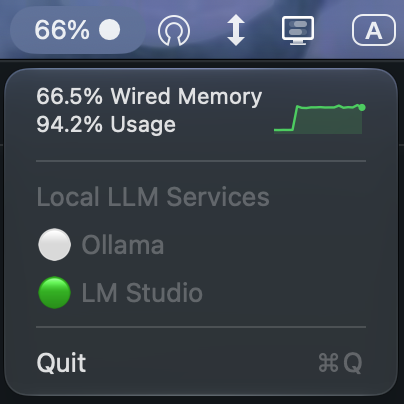

# Memory Monitor

A macOS menu-bar application that shows real-time memory usage, swap activity, memory pressure — and whether local LLM servers (Ollama and LM Studio) are running.

Memory data is collected with native system calls (`sysctl`, `host_statistics64`, `getpagesize`). LLM availability is checked by calling each service's local REST API over HTTP.

## Features

### Memory

- **Physical memory** — total, used, free, active, inactive, wired, speculative, purgeable
- **Swap memory** — total, used, free, usage percentage
- **Memory pressure** — green (normal), yellow (warning), red (critical)
- **Menu-bar widget** — live free-memory percentage with a pressure indicator, refreshed every 2 seconds
- **Console report** — `MemoryMonitor.printReport()` renders a formatted summary (library API)

### LLM services

- **Ollama** — checks `GET http://localhost:11434/api/tags`
- **LM Studio** — checks `GET http://localhost:1234/v1/models`
- Status appears in the dropdown as `Ollama: On/Off` and `LM Studio: On/Off`
- Statuses are primed at launch and refreshed every 2 seconds alongside the memory display
- A service counts as **On** only when its API responds with HTTP 2xx within 2 seconds; any non-2xx response, timeout, or connection error is reported as **Off**
- Checks run in the background — the UI never blocks — and only localhost is contacted

## Menu preview



The status-bar title shows free memory and pressure, for example:
 ```
 48% ●  |  80% ▲  |   99% ⚠
 ```

## Requirements

- macOS 14.0 or later
- [Swift Command Line Tools](https://developer.apple.com/download/all/) (Swift 5.10+)
  - No Xcode required

## Build & Run

### Menu-bar application

```bash
swift build -c release
./.build/release/MemoryMonitorApp
```

The app adds a status item to the menu bar and runs until you choose **Quit**.

### Tests

```bash
swift run MemoryMonitorTestsRunner
```

All test functions should pass. Exit code `0` means all passed; `1` indicates failures.

> The test runner must be built in debug mode (not release) because it uses `@testable import MemoryMonitorLib`.

### Console report

`MemoryMonitor.printReport()` is available from `MemoryMonitorLib` but is not invoked by the menu-bar executable. Call it from your own executable or playground, for example:

```swift
MemoryMonitor.printReport()
```

## Testing

The custom runner (`Tests/MemoryMonitorTests/MemoryMonitorTests.swift`, no XCTest) covers:

- Memory collection and field sanity checks
- Swap accounting (`used + free == total`) and usage percentage
- Pressure enum cases and descriptions
- Byte formatting across B/KB/MB/GB/TB
- Stability across repeated `collect()` calls
- LLM reporter configuration (names, ports, health-check paths)
- LLM reporter On/Off behavior for HTTP 200, HTTP 500, and connection failures (using a stubbed `URLProtocol`, so no real servers are required)

## Project structure

```
Package.swift
├── Sources/MemoryMonitorLib/
│   ├── MemoryMonitor.swift      # Memory collection, byte formatting, console report
│   └── LLMStatusReporter.swift  # LLMStatusReporter protocol, shared probe, Ollama + LM Studio
├── Sources/MemoryMonitorApp/
│   ├── MenuBarApp.swift         # AppKit status item, menu, timers, LLM status items
│   └── main.swift
└── Tests/MemoryMonitorTests/
    └── MemoryMonitorTests.swift # Custom executable test runner
```

## Targets

| Target | Type | Description |
|---|---|---|
| `MemoryMonitorLib` | Library | Memory collection and LLM status reporters |
| `MemoryMonitorApp` | Executable | Menu-bar application (AppKit) |
| `MemoryMonitorTestsRunner` | Executable | Manual test runner (15 test functions) |

## Extending LLM support

Implement the `LLMStatusReporter` protocol and add the reporter to the array in `MenuBarApp.main()`:

```swift
public protocol LLMStatusReporter {
    var name: String { get }
    var endpoint: URL { get }
    func checkStatus() async -> LLMServiceStatus
}
```

The shared `LLMStatusProbe` handles the HTTP request, timeout, and status-code interpretation. Reporters accept a custom `endpoint` and `URLSession` in their initializers, which also makes them straightforward to test.
